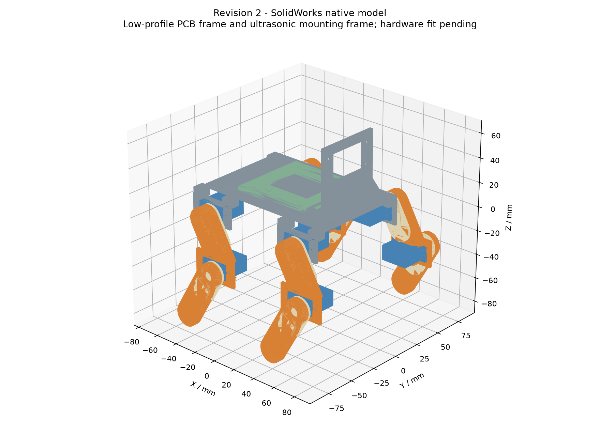

# 四足机器人课程设计 · 第 3 组

北京大学 2026–2027 学年秋季学期《先进制造与机器人实践》第 3 组。

当前为基于实物试装反馈的 **R2（2026-10-22）**。使用八个 180° 舵机，每腿两自由度；增加主板低矮固定框及 HC-SR04 可拆立板。主板已装配完成，从上方已有接口接线，不额外增加支撑柱。电池仍仅记录，不设计安装。

## 入口

- [SolidWorks 原生装配](cad/current/robot.SLDASM)：35 个组件，定位固定，未建立运动配合。
- [SolidWorks 原生零件](cad/current/parts/)：8 种，具有原生草图、拉伸与切除特征。
- [打印 STL](cad/current/print/)：8 种、19 件，文件名 xN 表示总打印数量；已调整打印朝向。
- [新版打印包](releases/QuadrupedRobot_Print_R2.zip)：仅当前 STL、数量清单和修改/打印说明。
- [小批试装包](releases/QuadrupedRobot_Fit_Test_R2.zip)：先打印单腿4件，主板固定框和超声波平面孔距规可选；每件均只打印1份。
- [尺寸、间隙、安装与打印说明](docs/版本2修改说明.md)。
- [交换格式](cad/current/step/)及[整机 STEP](cad/current/robot.step)。
- [检查报告](cad/current/validation.json)及[SolidWorks 重建检查](cad/current/native_validation.tsv)。



## 结构与验证范围

主板孔中心距 48.6 × 39.0 mm，使用 M2 紧固件及 3 mm 厚低矮固定框，无额外支撑柱；超声波孔中心距约 42 × 17 mm，采用可调孔。舵机与舵臂以 hardware/reference 中的新附件为基准，舵臂后四孔按用户净距离修正，腿件不依赖小孔承力。

零件实体、网格及静态装配检查已执行，具体结果见报告。这些检查不替代实物配合、螺钉与线缆避让、负载和步态测试；没有凭照片构造精确 PCB/传感器实体。旧版本孔位及压板不应混用。工程图工作仍暂停。

## 精简后的目录

```text
cad/current/          当前原生 CAD、STEP、打印 STL、装配清单及检查结果
hardware/reference/  用户提供的新原生参考模型与实测修订舵臂
hardware/electronics/原始电子工程资料
docs/                当前版本说明
releases/            当前打印包
scripts/             当前 SolidWorks 建模、验证与打包工具
```

不要移动单独的装配文件。复制 CAD 时保留 cad 和 hardware 的目录关系；跨电脑交付也可在 SolidWorks 中使用 Pack and Go。

## 重新生成

在运行本机 SolidWorks 2026 后，使用 Windows PowerShell 5.1：

```powershell
powershell.exe -NoProfile -ExecutionPolicy Bypass -File scripts/revise_solidworks.ps1 -Action Build
powershell.exe -NoProfile -ExecutionPolicy Bypass -File scripts/revise_solidworks.ps1 -Action Assembly
powershell.exe -NoProfile -ExecutionPolicy Bypass -File scripts/revise_solidworks.ps1 -Action Audit
python scripts/verify_current.py
python scripts/package_current.py
```

原生建模由 SolidWorks COM API 完成；Python 读取其 STEP 导出，执行几何检查并生成打印网格，不替代原生建模。Python 依赖见 requirements.txt，本地 .cad_runtime 仅为忽略的运行依赖。
