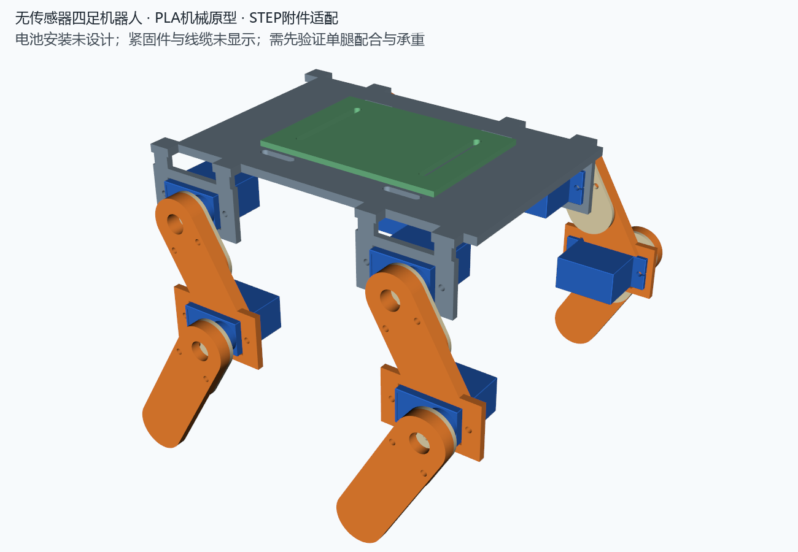

# 四足机器人课程设计 · 第 3 组

**北京大学 2026–2027 学年秋季学期《先进制造与机器人实践》课程第 3 组课程设计。**

本项目设计并制作一台使用 8 个舵机的四足机器人。首版不安装外部传感器，每条腿配置髋部与膝部两个舵机，目标是实现平整地面上的直线行走与转弯。



## 当前进度

- 已基于舵机及转头的 STEP 模型生成主体、大腿、小腿、转头压板和暂定主板托盘。
- 提供整机装配 STEP、逐件 STEP/STL、安装配合试片和可修改的 Python 建模脚本。
- 当前静态装配和前左腿 9 个抽样姿态未检出超过 0.01 mm³ 的实体交叠；逐件 STL 网格检查通过。
- 尚未完成实物试装、承重、连续运动与行走测试；紧固件和线缆未纳入碰撞模型。
- 转头接口目前采用近似包覆槽与压板，存在需调整的配合间隙，不能据此保证夹持可靠。建议先打印试片和一套单腿验证。

## 硬件与设计边界

|项目|配置|
|---|---|
|舵机|TS90A 9g、180°角度定位版本，共 8 个|
|腿部结构|髋关节俯仰＋膝关节直接驱动，无侧摆关节|
|暂定轴距|大腿 40 mm，小腿 45 mm|
|主体主平台|120 × 80 × 3 mm|
|当前站姿装配包络|约 142 × 147 × 102.11 mm|
|打印|Bambu 打印机，PLA；具体喷嘴和机器型号待确认|
|PCB 安装|专用固定孔位置暂未确定，绿色托盘为可选占位件|
|电池记录|紫色 603040 锂电池，3.7 V、800 mAh；本阶段未设计电池安装|

两自由度腿的转弯拟通过左右腿的步幅差异及足端滑移实现，实际效果和稳定性需实机验证。

## 目录结构

```text
QuadrupedRobot/
├── scripts/                 # 建模、预览、检查与打包脚本
├── hardware/
│   ├── reference/           # 舵机、转头的原始 STEP 与参考网格
│   └── electronics/         # 原理图与 PCB 工程资料
├── cad/
│   ├── prototype/
│   │   ├── step/            # 当前装配与逐件 CAD
│   │   └── stl/             # 当前逐件打印模型
│   └── fit_coupon/          # 舵机安装配合试片
├── docs/
│   ├── images/              # 装配预览、尺寸图与连接示意
│   └── reports/             # 参数记录、几何与网格检查结果
├── archive/layout/          # 早期布局草案，非当前打印模型
├── releases/                # 按当前目录结构生成的完整压缩包
├── requirements.txt
└── README.md
```

|入口|内容|
|---|---|
|[整机装配 STEP](cad/prototype/step/quadruped_prototype_assembly.step)|含舵机和原装转头参考体的装配模型|
|[逐件 STL](cad/prototype/stl/)|当前可用于试装打印的零件|
|[安装配合试片](cad/fit_coupon/)|建议先打印的接口验证件|
|[打印与装配说明](docs/打印与装配说明.md)|打印数量、方向、装配顺序及验证边界|
|[转头连接说明](docs/images/转头连接说明.png)|转头形状与连接层次|
|[设计方案](docs/设计方案.md)|需求、方案历史与载荷示例|
|[重新生成说明](docs/重新生成说明.md)|建模环境与脚本入口|
|[验证报告](docs/reports/)|参数、静态碰撞、抽样姿态及网格检查记录|
|[电子工程资料](hardware/electronics/)|现有原理图及 PCB 工程，尚未完成机械安装适配|
|[完整原型包](releases/QuadrupedRobot_PLA_Prototype.zip)|源码、CAD、参考资料与文档的打包副本|

`hardware/reference/` 中的 `*_reference.stl` 是舵机和转头的参考网格，不需要打印。`archive/layout/` 仅保留历史布局，不能作为承力腿打印。STEP 可作为导入实体在 SolidWorks 等 CAD 软件中打开，不含原生特征树。

## 重新生成

使用 Python 3.12，在项目目录执行：

```powershell
python -m pip install --target .cad_runtime -r requirements.txt
python scripts/build_prototype.py
python scripts/render_prototype.py
python scripts/check_stl.py
```

主要参数位于 `scripts/build_prototype.py` 开头的 `P` 字典；`docs/reports/parameters.json` 是生成记录。修改后需重新检查实体连接、干涉和打印配合。本地 `.cad_runtime/` 依赖目录不提交到仓库。

生成分发包：`python scripts/package_project.py`。脚本使用仓库位置定位输入和输出，不依赖终端当前目录。
